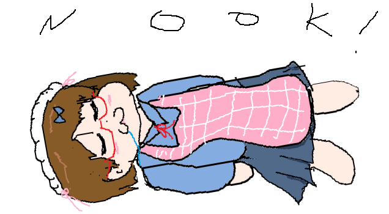

# Nok Project Repo
My self-sufficiency programming project repository

## List

- [harpscript](https://github.com/Noksek2/harp_script)
- [ipariscript](https://github.com/Noksek2/ipari-script)
- [mystd_noksek](https://github.com/Noksek2/mystd_noksek)
- [myalgorithm](https://github.com/Noksek2/myalgorithm)
- [myNLP](https://github.com/Noksek2/myNLP)
- [myANN](https://github.com/Noksek2/MyNeuralNetwork)
  
Partially 
- WinPaint2d (private)
- [ImageCompressor](https://github.com/Noksek2/ImageCompressor)

## Report?

| name | difficulty(n/5) | period | lang/st | ongoing? | 
| --- | --- | --- |  --- | --- |
| harpscript | 3.5/5 | long (>6 month) | C++ | yes |
| mystd_noksek(except myallocator) | 1.5/5 | long (>6 month) | C | yes |
| mystd_noksek - myallocator | 4/5 | short (<2 month) | C | pause |
| WinPaint2d | 4/5 | C++ | long (>6 month) | wait |
| ipariscript | 2.5/5 | C++ | short (<3 month) | stop |
| etc | ? | ? | ? | stop or pause |

## Policy in Nok Project
1. AI Agent (Claude Code, Codex, Github Copilot, etc) Forbidden.
  
2. LLM Chatbot use only in part
- Search, Personal Study, Idea Review, Troubleshooting

3. AI-generated code is limited to the following.
- Boilerplate
- Overly repetitive code pattern
- Documentation, Translation (.README, etc)
- Benchmarking test, deployment phase. (ex : mystd_noksek's benchmark code)

Even in this case, Cannot directly use AI-generated code, and the source must be clearly cited. If ratios or principles are violated, the document - source code must be rewritten. Otherwise, it will be excluded from the Nok Project.

4. Code Protection Principles

Not necessarily released as open source, especially in github.

## Clawn Code

In contrast to the Nok project, there is the `ClawnCode Project`

`ClawnCode Project`  exhibits AI code generation and strong agent dependency.

https://github.com/Noksek2/ClawnCodeRepo

## Why?
By minimizing external library dependencies, The goal is to build my own system.

so ClawnCode is not my pure job.

## Sad Point
who cares 😇

### hi nokchan 

oops,, she be sleep now
